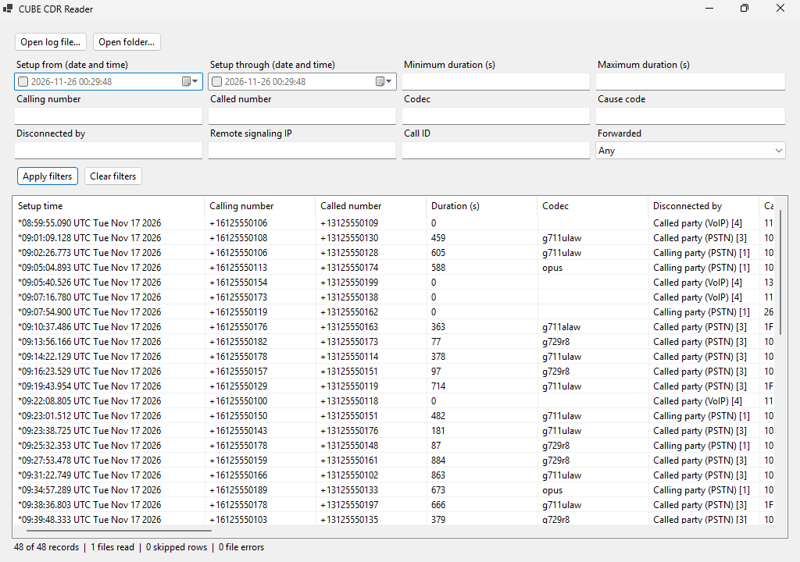

# CUBE CDR Reader

CUBE CDR Reader opens the call records (CDRs) that a Cisco Unified Border Element (CUBE) writes, and shows them as a table you can sort and filter. Use it to answer questions like "which calls to this number failed yesterday?" without reading raw log files. It only reads your files and never changes them.




## Download and run (Windows)

1. Download **[CUBE-CDR-Reader-Win-x64.exe](https://github.com/jcliff01/CUBE-CDR-Reader/releases/latest/download/CUBE-CDR-Reader-Win-x64.exe)** from the [latest release](https://github.com/jcliff01/CUBE-CDR-Reader/releases/latest). It is one file with everything included; there is nothing to install.
2. Double-click it.
3. If Windows shows **"Windows protected your PC"**, click **More info**, then **Run anyway**. The program isn't code-signed, so Windows doesn't recognize the publisher.
4. Click **Open log file…** to open one file, or **Open folder…** to open every record file in a folder. You can also drag a file or folder onto the window or onto CUBE-CDR-Reader.exe.

**Older or locked-down PC?** The original portable version is a 43 KB program that also runs without anything installed. It has fewer filters. Download `CUBE-CDR-Reader-Portable-C.exe` from the [latest release](https://github.com/jcliff01/CUBE-CDR-Reader/releases/latest), or see [`legacy/c-portable`](legacy/c-portable) for the program and its source code.

## macOS and Linux

The reader is a Windows program. On a Mac or Linux computer, run it inside a Windows virtual machine (for example Parallels on a Mac, or VirtualBox on Linux). It doesn't run under Wine.

## Try it with the sample file

The file [`samples/sample-cdrs.csv`](samples/sample-cdrs.csv) holds 48 made-up calls (every number and address is invented). Download it, then open it with **Open log file…**, or drag it onto CUBE-CDR-Reader.exe. The picture above shows that file.

## Which files it reads

- The CUBE's file-accounting records, in either the detailed or the compact format (the files have no header row).
- CSV exports with column names such as `h323-setup-time`, `clid`, `dnis` and `duration-seconds`.

When you open a folder, it reads the files directly in that folder, not in subfolders: files ending in `.csv`, `.cdr`, `.log` or `.txt`, files with no extension, and files ending in a number. It loads up to 250,000 records. The status bar at the bottom shows how many lines it skipped and any files it couldn't read.

One call can have several records, one for each call leg.

## Filtering

There are twelve filters: setup time from and through, minimum and maximum duration, calling number, called number, codec, cause code, who disconnected, remote signaling IP, call ID, and whether the call was forwarded.

1. Fill in the filters you want. Leave the others empty.
2. Click **Apply filters**. A record is shown only if it matches every filter you filled in.
3. Click **Clear filters** to show everything again.

Text filters match part of a value and ignore upper and lower case: `555` finds `+15551234`. Click a column heading to sort by it.

## Saving and copying results

- **Export to CSV…** saves the rows currently shown (after filtering and sorting) as a CSV file that opens in Excel.
- Select rows and press **Ctrl+C** to copy them, with column headings, ready to paste into a spreadsheet. **Ctrl+A** selects every row shown. Right-click the table for the same options.

Durations come from the record's duration in seconds when it has one. Otherwise the reader works them out from the connect and disconnect times. Setup-time filters use the CUBE's own clock, and the "through" time includes the whole second you pick.

## Troubleshooting

| What you see | What to do |
| --- | --- |
| Windows won't open the file | See step 3 above. Some company PCs block unsigned programs; ask IT to allow it. |
| Fewer rows than you expected | Check the skipped-line count in the status bar. Lines that aren't call records are skipped on purpose. |
| A file is listed as an error | Another program may be holding it locked, or you don't have permission to read it. |
| Stops at 250,000 records | Open a smaller folder, or fewer days of files. |

## Sharing examples

Call records hold phone numbers and network addresses. Before attaching records to a bug report, replace the calling and called numbers, IP addresses and call IDs with made-up values. Say which version you used and which record format the file is in.

## Build it yourself (developers)

You need the [.NET 8 SDK](https://dotnet.microsoft.com/download/dotnet/8.0) (`winget install Microsoft.DotNet.SDK.8`).

| Folder | What it is |
| --- | --- |
| `src/CubeCdrReader.Core` | Reading, parsing, filtering and CSV export. No Windows dependencies. |
| `src/CubeCdrReader` | The Windows app (Windows Forms). |
| `tests/CubeCdrReader.Tests` | Tests for the core library. They run on Windows, macOS or Linux. |
| `legacy/c-portable` | The original portable C version. |

Run the tests (any OS):

```sh
dotnet test tests/CubeCdrReader.Tests
```

Build the program (Windows, in PowerShell):

```powershell
dotnet publish src/CubeCdrReader/CubeCdrReader.csproj -c Release -r win-x64 --self-contained true -p:PublishSingleFile=true -p:IncludeNativeLibrariesForSelfExtract=true -p:EnableCompressionInSingleFile=true -o publish
```

The program is `publish\CUBE-CDR-Reader.exe`.

**To publish a release:** set `<Version>` in `Directory.Build.props`, add a section to [CHANGELOG.md](CHANGELOG.md), then push a matching tag such as `v1.1.0`. The **Publish Windows x64 release** workflow runs the tests, builds the program and attaches it, the portable C version and SHA-256 checksums to a release of the same name.

Format reference: [Cisco IOS Voice Gateway CDR accounting](https://www.cisco.com/c/en/us/td/docs/ios/voice/cdr/developer/manual/cdrdev.pdf).

## License

[MIT](LICENSE).
